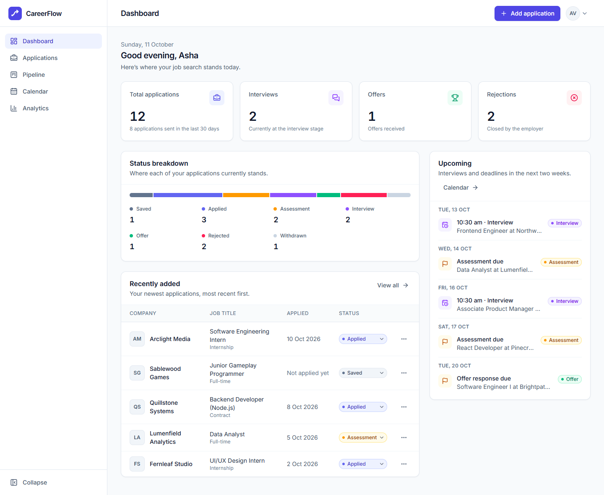
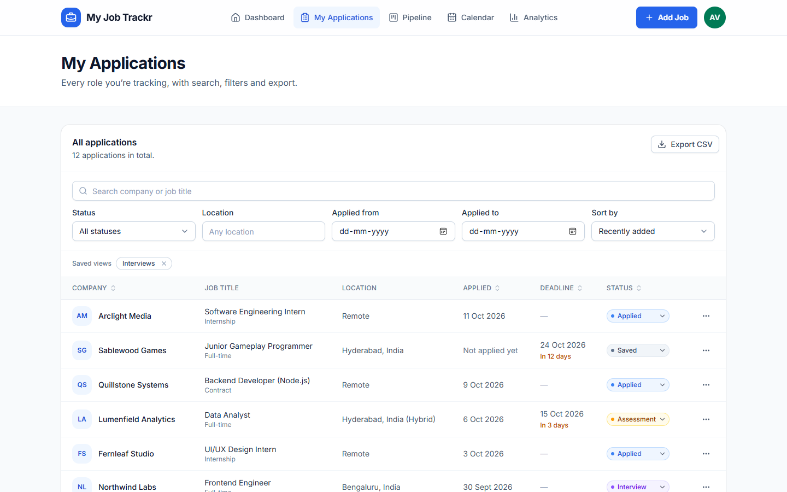
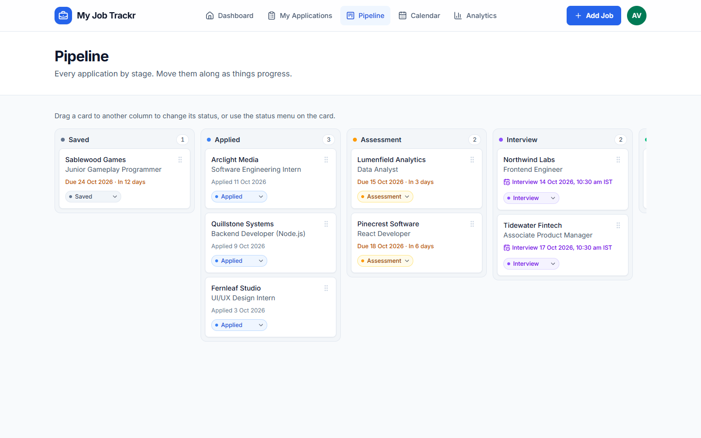
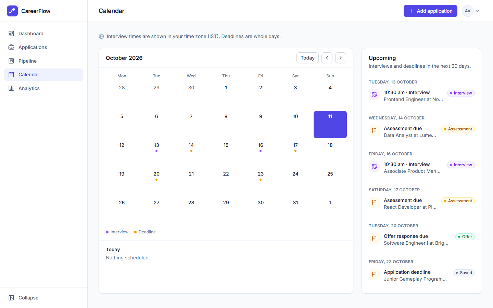
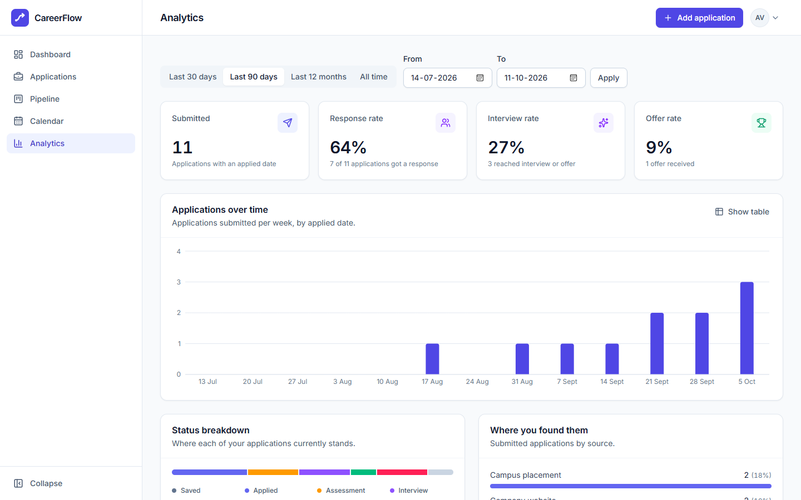
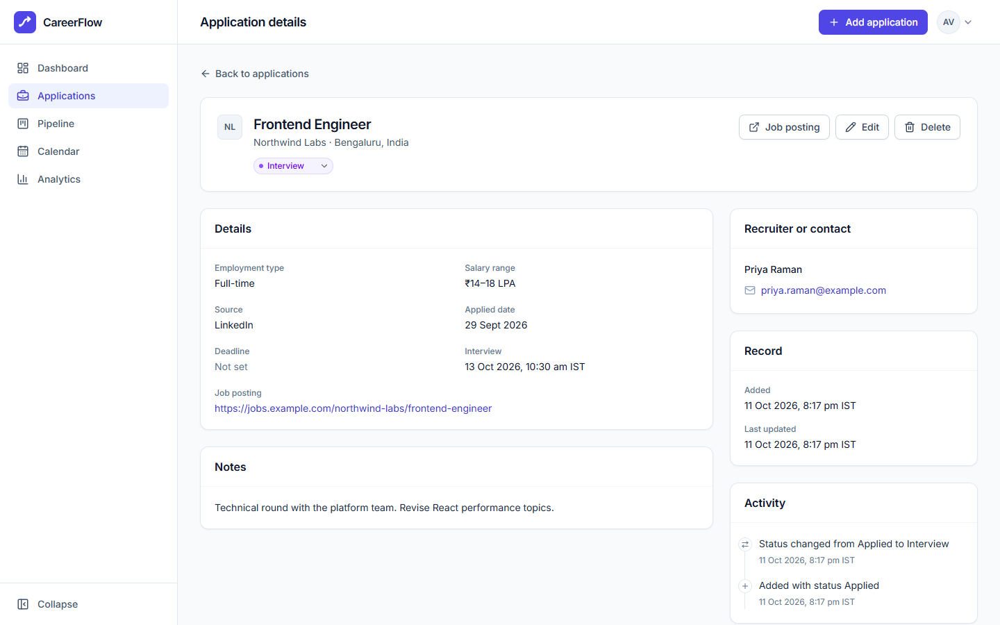
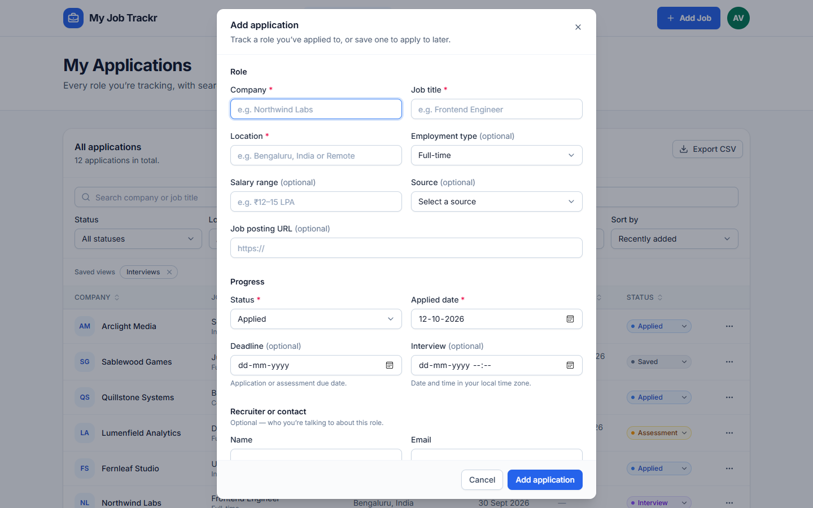
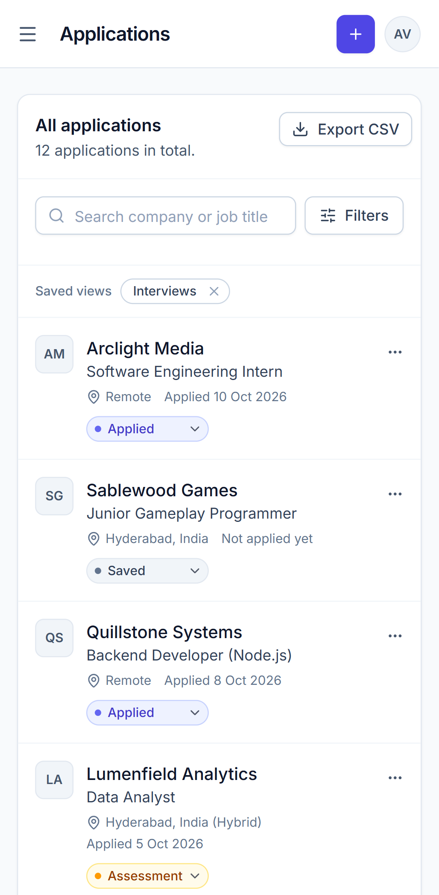
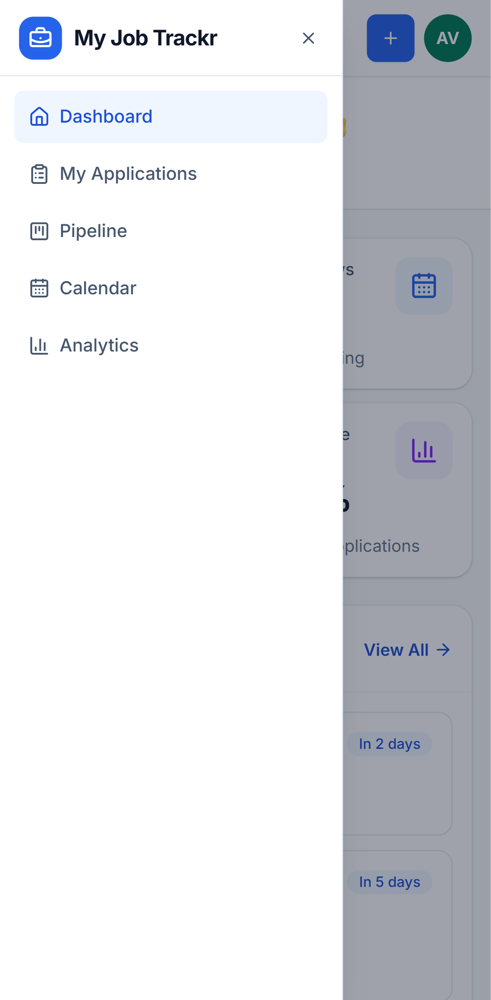
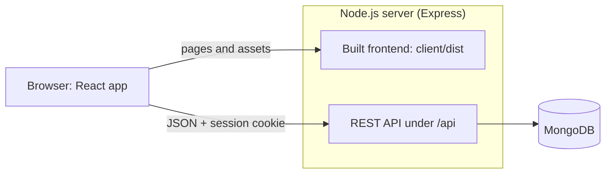

# CareerFlow

A job application tracker for students and job seekers. Every application, interview, deadline, and recruiter conversation lives in one place, with a Kanban pipeline, a calendar, and analytics on how your search is going.



**Live demo:** [careerflow-51i3.onrender.com](https://careerflow-51i3.onrender.com). Create an account to try it. It runs on Render's free plan, so the first visit after 15 idle minutes takes about a minute while the server wakes up. It's a demo: please don't enter sensitive personal information. To run your own copy, see [Deployment](#deployment).

## Features

- **Dashboard:** totals, interviews, offers, rejections, a status breakdown, and recently added applications.
- **Applications list:**
  - Search by company or job title.
  - Filter by status, location, and applied-date range.
  - Sort from the menu or by clicking column headers.
  - Pagination with 10, 25, or 50 rows.
  - Search, filters, sort, and page are kept in the URL, so a view can be bookmarked or shared.
- **Add, view, edit, and delete** applications. Deleting asks for confirmation.
- **Inline status changes** from any list or the details page. The change shows immediately and is undone if saving fails. Moving a saved job to a submitted status records today as the applied date.
- **Accounts:** sign up, sign in, and sign out, with protected pages that return you to where you were after signing in. **Account settings** let you change your name, your email (requires your current password), and your password (signs out your other devices).
- **Pipeline (Kanban):** one column per status. Drag a card to change its status, or use the status menu on each card, which is the keyboard and touch alternative. Moves show immediately and roll back if saving fails.
- **Analytics:** submitted applications, response, interview, and offer rates (with written definitions), applications over time (with a table view), status breakdown, and sources. Choose the last 30 or 90 days, the last 12 months, all time, or custom dates.
- **Calendar & agenda:** a month grid with keyboard navigation, a 30-day agenda, and an "Upcoming" card on the dashboard. Interview times show in your time zone; deadlines are labelled by stage ("Assessment due", "Offer response due", …). Rejected and withdrawn applications stay on the month grid as history but are left out of "Upcoming".
- **Activity timeline:** creation, status changes, and edited fields are recorded on each application from now on. Field values are never logged, and history isn't invented for older records.
- **CSV export** of the current search and filters, with spreadsheet-safe escaping.
- **Saved views:** name and re-apply sets of filters, stored per account.
- **Full application record:** company, title, location, job URL, employment type, salary range, source, applied date, deadline, interview date and time, recruiter contact, notes, and created/updated timestamps.
- **Accessible and responsive:** keyboard-only use, screen-reader labels, and WCAG 2.1 AA colour contrast (checked automatically with axe-core), and layouts that work from phone to desktop.

## Screenshots

| | |
| --- | --- |
|  |  |
| **Applications:** search, filters, sorting, saved views, and CSV export | **Pipeline:** drag a card, or use its status menu |
|  |  |
| **Calendar:** interviews in your time zone, deadlines by stage | **Analytics:** rates with written definitions and a table view |
|  |  |
| **Details:** everything about one application, with its history | **Add application:** validated form in an accessible dialog |

<p>
  
  &nbsp;
  
</p>

The screenshots show CareerFlow's fictional sample data (the same as `npm run seed`). They're captured from the running app by `npm run screenshots` in `e2e/`.

## Tech stack

| Layer | Technology |
| --- | --- |
| Frontend | React 19, Vite 8, React Router 7, TanStack Query 5, Tailwind CSS 4, Recharts, lucide-react |
| Backend | Node.js, Express 5, MongoDB with Mongoose 9, zod (validation) |
| Security | bcrypt (`bcryptjs`), JWT (`jose`) in HttpOnly cookies, Helmet, CORS, CSRF checks, `express-rate-limit` |
| Testing | Vitest and Testing Library (UI), Vitest, supertest, and mongodb-memory-server (API), Playwright and axe-core (browser end-to-end and accessibility) |
| Delivery | GitHub Actions (CI), Render Blueprint (`render.yaml`), MongoDB Atlas |

## How it fits together



- **Production:** one Node.js server serves the built frontend and the API from the same origin. There's no CORS to configure, and the session cookie stays first-party.
- **Development:** Vite serves the frontend with hot reload on port 5173 and forwards `/api` to the API on port 4000.

### Frontend data flow

```
Pages → hooks/useApplicationData.js (TanStack Query: cache, loading/error states, invalidation)
      → services/applicationService.js
          ├─ apiApplicationService.js → apiClient.js → /api (default; always in production)
          └─ mockApplicationService.js (VITE_DATA_SOURCE=mock, development and tests only)
```

| Screen | Requests |
| --- | --- |
| Dashboard | `GET /applications/stats?appliedSince=<local date 29 days ago>` and `GET /applications?sort=createdAt&order=desc&pageSize=5` |
| Applications | `GET /applications?q=…&status=…&location=…&from=…&to=…&sort=…&order=…&page=…&pageSize=…`. The parameters mirror the page URL. |
| Details | `GET /applications/:id` |
| Account | `PATCH /users/me`, `PUT /users/me/password` |

Every change updates or invalidates the affected cache entries (lists, details, and dashboard numbers), so screens stay in sync without manual refreshes.
- **Status changes** are optimistic: every cached view updates at once and is restored if the save fails.
- **Pagination:** while the next page or filter loads, the previous results stay visible, dimmed.
- **Account switches:** the whole cache is emptied whenever the signed-in user changes, so one account's data is never shown to another.
- **Dashboard numbers** revalidate each time a screen that shows them opens, which picks up changes made on other devices.

The sample-data service mirrors the API exactly (filtering via `utils/applicationQuery.js`, response shapes, errors, paging), which keeps the UI tests meaningful. It's loaded through a dynamic import guarded by a condition that is statically false in production builds, so it isn't included in the production bundle at all.

### Design decisions

- **Dates:**
  - Calendar dates (applied date, deadline) are stored as `YYYY-MM-DD` strings and read in local time, which avoids off-by-one-day timezone bugs.
  - Interview times are entered in the user's local time zone, stored as UTC ISO 8601 instants, and displayed with the time-zone name.
- **Modals and the mobile drawer** use the native `<dialog>` element for focus trapping, Escape handling, and inert backgrounds. Focus returns to the trigger on close.
- **Menus** render in a portal with fixed positioning, so scrolling tables can't clip them. They follow the WAI-ARIA menu-button pattern: arrow keys, Home/End, Escape, and focus return.
- **Text filters** update the URL after a 300 ms pause, so typing stays responsive and the browser history isn't flooded.
- **Validation runs in layers.** Client-side checks exist for user experience. The API validates every request with zod, which strips unknown fields, so a client can never set `userId`, `_id`, or timestamps. The Mongoose schema enforces the same rules again before saving.
- **Activity recording is best-effort.** It's written after the change succeeds, and a failed history write is logged rather than failing your save, because MongoDB transactions need a replica set that local and free-tier setups may not have. Only field *names* are recorded, so notes and contact details never enter the log.
- **Analytics definitions:** *Submitted* = applications with an applied date in the range. Response, interview, and offer rates divide by Submitted and use each application's current status, so an application rejected after an interview counts as Rejected. History-based rates would need activity data that older records don't have. The same calculation runs on the server and in the sample-data service.
- **CSV safety:** RFC 4180 quoting (commas, quotes, newlines), CRLF line endings, a UTF-8 byte-order mark for Excel, and cells starting with `=`, `+`, `-`, `@`, tab, or CR prefixed with `'` so spreadsheets don't run them as formulas (CSV injection).
- **Time zones in the calendar:** the client sends its local day range both as calendar dates (deadlines have no time) and as UTC instants (interviews do), so every event lands on the right local day.
- **Indexes:** every index starts with `userId` (`{userId, createdAt}`, `{userId, status}`, `{userId, appliedDate}`, `{userId, deadline}`), because every query is scoped by owner. Tests run MongoDB's `explain()` on the real list and stats queries and fail on a collection scan. Case-insensitive collation is applied only when sorting by company, because string comparisons can use an index only when the collations match.
- **One service contract:** `apiApplicationService.js` and `mockApplicationService.js` share function signatures, response shapes (`{ items, meta }`), and error types (`ValidationError`, `NotFoundError`, `ApiError`), so the UI doesn't know which one is active.
- **Retries:** queries retry only transient failures (network errors, timeouts, 5xx), at most twice. Writes are never retried automatically, to avoid duplicates. Submit buttons lock while saving.
- **Ownership:** every database query includes the authenticated owner's `userId`, taken from the verified session and never from the request. Records belonging to other users return 404, the same as missing ones, so their existence isn't revealed.

## Run it locally

**Requirements:** Node.js `^20.19.0` or `>=22.12.0` (Node 22 LTS recommended; `.node-version` pins 22 for hosting), npm 10+, and MongoDB 7+ (a local install, Docker, or Atlas).

```bash
npm run install:all                      # installs server, client, and e2e dependencies
cp server/.env.example server/.env       # then set JWT_SECRET (and MONGODB_URI if needed)
npm run dev:server                       # API on http://localhost:4000
npm run dev:client                       # in a second terminal: app on http://localhost:5173
```

Generate a `JWT_SECRET` with `node -e "console.log(require('crypto').randomBytes(48).toString('base64url'))"`. To run MongoDB with Docker: `docker run -d --name careerflow-mongo -p 27017:27017 mongo:8`.

Create an account on the sign-up page. To fill it with the sample applications, run this in `server/`: `npm run seed -- --email you@example.com`. The seed script is for development only: it refuses to run in production, never creates accounts, and won't touch an account that already has data unless you add `--reset`.

**Frontend only (no server):** create `client/.env.local` containing `VITE_DATA_SOURCE=mock` to switch the development build to in-memory sample data with no sign-in. Production builds ignore this setting and always use the API.

| Command (repo root) | What it does |
| --- | --- |
| `npm run install:all` | Install dependencies for `server/`, `client/`, and `e2e/` |
| `npm run dev:server` / `npm run dev:client` | Start the API (restarts on changes) / the Vite dev server |
| `npm run lint` | ESLint for server and client |
| `npm test` | API tests, then UI tests |
| `npm run test:e2e` | Browser end-to-end tests (see [Testing](#testing)) |
| `npm run build` | Build the frontend into `client/dist` |
| `npm run build:deploy` | What hosting runs: clean installs, the frontend build, and server production dependencies only |
| `npm start` | Start the server; with `NODE_ENV=production` it also serves `client/dist` |

## Configuration

### Server (`server/.env` locally; the host's environment settings in production)

| Variable | Required | Default | Purpose |
| --- | --- | --- | --- |
| `NODE_ENV` | no | `development` | `development` or `production` (tests use `test`) |
| `PORT` | no | `4000` | HTTP port. Hosting platforms usually set it. |
| `MONGODB_URI` | yes | — | MongoDB connection string. A secret: never committed, never logged (credentials are masked). |
| `JWT_SECRET` | yes | — | Signs session tokens. A secret: at least 32 random characters, unique per environment. |
| `CLIENT_ORIGIN` | no | `http://localhost:5173` in development; none in production | Comma-separated origins of a frontend hosted *elsewhere*, for CORS (e.g. `https://app.example.com`). The server's own origin is always allowed. Entries must be bare origins (no path); a trailing slash is ignored. |
| `SERVE_CLIENT` | no | `true` in production | Serve the built frontend from this server. Set `false` when the frontend is hosted separately. |
| `CLIENT_DIST_DIR` | no | `client/dist` | Where the built frontend is |
| `TRUST_PROXY` | no | `0` | Number of proxies in front of the server (`1` on Render and most platforms), for correct client IPs and HTTPS detection |
| `SESSION_DAYS` | no | `7` | How long a sign-in lasts |
| `COOKIE_SECURE` | no | `true` in production | Send the session cookie over HTTPS only |
| `COOKIE_SAMESITE` | no | `lax` | `lax`, `strict`, or `none` (`none` requires `COOKIE_SECURE=true`) |
| `BCRYPT_ROUNDS` | no | `12` | bcrypt cost (at least 10 in production; tests use 4) |
| `LOGIN_RATE_LIMIT` | no | `10` | Failed sign-ins allowed per IP per 15 minutes. Keep the default in production. |
| `SIGNUP_RATE_LIMIT` | no | `10` | Sign-ups allowed per IP per hour |

The server validates its configuration at startup and refuses to start with a missing or invalid setting. The error names the variable but never prints its value.

### Frontend (build time, `client/.env.local`)

| Variable | Default | Purpose |
| --- | --- | --- |
| `VITE_API_BASE_URL` | `/api` | Only for a frontend hosted on a different domain from the API, e.g. `https://api.example.com/api` |
| `VITE_DATA_SOURCE` | `api` | `mock` for in-memory sample data in development; ignored in production builds |

`VITE_*` values are compiled into the public JavaScript bundle, so they must never contain secrets.

## Deployment

The recommended setup is **one web service on Render plus a free MongoDB Atlas cluster**. `render.yaml` describes the service, so most of the setup is automatic.

### 1. Create the database (MongoDB Atlas)

1. **Create a cluster:** create an Atlas project and a free M0 cluster. Pick the region closest to your Render region: `render.yaml` uses Singapore, so choose an Asian AWS region such as Singapore or Mumbai.
2. **Create a database user:** under *Database Access*, add a user with a generated password and *Specific privileges → `readWrite` on database `careerflow`*.
3. **Allow network access:** under *Network Access*, add Render's outbound IP ranges for your region. They're shown in the service's *Connect → Outbound* tab once it exists, and are shared by every service in that region. If you can't use them, allow `0.0.0.0/0`; the generated password and TLS, which Atlas always uses, then protect the database.
4. **Copy the connection string:** *Connect → Drivers* gives `mongodb+srv://…`.
   - **Add the database name** before the `?`: `…mongodb.net/careerflow?retryWrites=true&w=majority`. Without it, data goes to a database called `test`, and the server logs a warning.
   - **URL-encode** special characters in the password (`@` → `%40`, `:` → `%3A`, `/` → `%2F`).

| Problem | Likely cause |
| --- | --- |
| `Server selection timed out` | The server's IP isn't on the Atlas network access list |
| `bad auth : authentication failed` | Wrong user or password, or special characters not URL-encoded |
| Warning about the `test` database | Database name missing from the URI |

### 2. Deploy the app (Render)

1. Push this repository to GitHub.
2. In the Render Dashboard choose **New → Blueprint** and select the repository. Render reads `render.yaml` and creates one web service:
   - **Build:** `npm run build:deploy` (frontend build plus server production dependencies). **Start:** `npm start`.
   - **Health check:** `/api/health`. A deploy only receives traffic once the server is running *and* connected to MongoDB.
   - **Environment:** `NODE_ENV=production`, `TRUST_PROXY=1`. Render generates `JWT_SECRET` (256 random bits) and asks you for `MONGODB_URI` once; paste the Atlas connection string.
3. When the deploy finishes, open the URL Render shows (`https://<service-name>.onrender.com`) and create your account.

New pushes to `main` redeploy automatically. A custom domain needs no app changes: add it in the service's settings, and because pages and API share the origin there's nothing else to configure.

**Free plan:** the service sleeps after 15 minutes without traffic, and the next visit takes about a minute to wake it. Free services also get 750 instance hours a month. Data is safe either way, because it lives in Atlas.

### Check a deployment

```bash
curl https://<your-app>.onrender.com/api/health
```

It should answer `200` with `"status":"ok","database":"connected"`. Then sign up, add an application, and reload: it should still be there. In the browser's developer tools, the response headers include `Strict-Transport-Security` and `Content-Security-Policy`, and the `cf_session` cookie is `HttpOnly`, `Secure`, and `SameSite=Lax`.

### Other hosts

Any Node.js host works the same way: run `npm run build:deploy` to build, `npm start` to run, set `NODE_ENV=production`, `MONGODB_URI`, `JWT_SECRET`, and (behind the platform's proxy) `TRUST_PROXY=1`, and point the health check at `/api/health`. Use Node 22 LTS.

### Frontend on a separate domain (optional)

If the frontend must live elsewhere (a CDN or static host), build it with `VITE_API_BASE_URL=https://api.example.com/api`, and set `CLIENT_ORIGIN=https://app.example.com` and `SERVE_CLIENT=false` on the API.

- **Same site (recommended):** `app.example.com` and `api.example.com` share a site, so the default `SameSite=Lax` cookie keeps working and only CORS (`CLIENT_ORIGIN`) is needed.
- **Different sites** (e.g. `*.vercel.app` and `*.onrender.com`): this needs `COOKIE_SAMESITE=none` and `COOKIE_SECURE=true`, which turns the session into a third-party cookie. Safari and other browsers with tracking protection block third-party cookies, so users there couldn't stay signed in. Prefer a single service, a shared parent domain, or a host rewrite that proxies `/api` so the browser sees one origin.

### Secrets

| Secret | Production | Local | Rotating it |
| --- | --- | --- | --- |
| `MONGODB_URI` (database password) | Render environment variable, entered once in the dashboard | `server/.env` | Create a new password or user in Atlas, update the variable, let Render redeploy, then remove the old one |
| `JWT_SECRET` | Generated by Render | `server/.env` (generate your own) | Change the value and redeploy. Every session ends, so everyone signs in again. |

- **Never committed:** `.env` files are git-ignored, and only the value-free `.env.example` is tracked. The git history was scanned for credentials in Level 9 and contains none.
- **Never in the frontend:** `VITE_*` values are public, so the frontend bundle holds no secrets.
- **Never echoed:** configuration errors name the variable, never its value; connection strings are masked in logs; passwords and tokens are never logged.
- **Tests use throwaway secrets:** the API tests use a test-only secret, and each end-to-end run generates a random one.

### Health check

`GET /api/health` is public and returns `200 {"data":{"status":"ok","database":"connected",…}}` while MongoDB is connected, or `503` with `"status":"degraded"` while it isn't. Hosting platforms use it to decide when a deploy can take traffic, and it works with any uptime monitor. While the database is down, other API requests fail fast with `503 DATABASE_UNAVAILABLE` and the app offers **Try again**; the driver reconnects automatically when the database comes back.

## Authentication and security

| Concern | Implementation |
| --- | --- |
| Passwords | bcrypt with cost 12 (`bcryptjs`, the same algorithm and hash format as native `bcrypt`, with no native build step). Passwords are 8–64 characters and at most 72 bytes, because bcrypt ignores anything longer. No composition rules, per current NIST guidance. Never stored, logged, or returned. |
| Sessions | A signed JWT (HS256, with `iss`, `aud`, and `exp`; 7 days by default) in a `cf_session` cookie that is HttpOnly, `SameSite=Lax`, `Secure` in production, and limited to `Path=/api`. JavaScript can't read it, so cross-site scripting can't steal it, and nothing is stored in localStorage. |
| Every request | `requireAuth` verifies the token and reloads the user, so deleted accounts are refused immediately. A `tokenVersion` mismatch means the session was revoked: changing the password signs out every other session. |
| CSRF | Three layers: the SameSite cookie; a required `X-CSRF-Protection: 1` header on every non-GET request (browsers only let allowed origins send it, after a CORS preflight); and a check that any `Origin` header is an allowed origin. |
| Brute force | Sign-in and password checks: 10 failed attempts per 15 minutes per IP (successful sign-ins don't count). Sign-up: 10 per hour per IP. Sign-in returns the same message, after the same amount of work, for unknown emails and wrong passwords. |
| Headers | Helmet on every response, including the pages and assets the server hosts in production: a Content Security Policy (`script-src 'self'`, no inline scripts), HSTS, `nosniff`, frame and referrer policies, and `Cross-Origin-Resource-Policy: same-site`. |
| CORS | In production only the server's own origin is allowed unless `CLIENT_ORIGIN` lists a separately hosted frontend. Origins are validated at startup and matched exactly, so look-alike domains get nothing. |
| Frontend | Protected routes redirect to `/login?next=…`; only same-app paths are accepted as `next`. Data providers live inside the signed-in layout, so signing out drops the previous user's data from memory. An expired or revoked session sends the user back to sign in. |

Rate limits are stored in memory, which is correct for a single server instance (Render's free plan runs one).

## API reference

Base URL: `/api`. Successful responses are `{ "data": … }`, and lists add `"meta"`. Errors are `{ "error": { "code", "message", "details?" } }`. Every route except `/health` and the sign-in and sign-up routes requires a session. Every non-GET request must send `X-CSRF-Protection: 1`.

| Method | Path | Success | Notes |
| --- | --- | --- | --- |
| GET | `/health` | 200 / 503 | Public. Reports API and database status. |
| POST | `/auth/register` | 201 | `{ name, email, password }`. Signs the user in (sets the cookie). Returns 409 `EMAIL_TAKEN` if the email is already registered. |
| POST | `/auth/login` | 200 | `{ email, password }`. Sets the cookie. Returns 401 `INVALID_CREDENTIALS` for a wrong email or password. |
| POST | `/auth/logout` | 204 | Clears the cookie. |
| GET | `/auth/me` | 200 | The current user `{ id, name, email, createdAt, updatedAt }`. |
| PATCH | `/users/me` | 200 | `{ name?, email?, currentPassword? }`. Changing the email requires `currentPassword`. |
| PUT | `/users/me/password` | 204 | `{ currentPassword, newPassword }`. Signs out all other sessions. |
| GET | `/applications` | 200 | Query: `q`, `status`, `location`, `from`, `to` (applied date, `YYYY-MM-DD`), `sort` (`createdAt`, `appliedDate`, `company`, `deadline`, `status`), `order` (`asc`/`desc`), `page`, `pageSize` (max 100). Returns `meta: { page, pageSize, total, pageCount }`. |
| POST | `/applications` | 201 | Required fields: `company`, `jobTitle`, `location`, `status`. Returns a `Location` header. |
| GET | `/applications/stats` | 200 | Counts by status, plus `appliedSince` (optional query `appliedSince=YYYY-MM-DD`; default is the last 30 days). |
| GET | `/applications/:id` | 200 | |
| PUT | `/applications/:id` | 200 | Any subset of fields. The merged record is validated as a whole. |
| DELETE | `/applications/:id` | 204 | Also deletes its activity history. |
| GET | `/applications/:id/activity` | 200 | Timeline entries, newest first: `created`, `status_changed` (`fromStatus`, `toStatus`), `updated` (`fields`: names only). |
| GET | `/applications/export` | 200 | CSV (`text/csv`, attachment, `Cache-Control: no-store`) of every application matching the list filters and sort; at most 5,000 rows. |
| GET | `/applications/analytics` | 200 | Query: `from`, `to` (applied dates, optional). Returns totals, rates (`null` when nothing was submitted), `byStatus`, `bySource`, and zero-filled `overTime` buckets (week, month, or year by range length). |
| GET | `/applications/events` | 200 | Query: `start`, `end` (local calendar dates, for deadlines) and `startAt`, `endAt` (UTC instants, for interviews); range of at most 400 days. |
| GET | `/views` | 200 | The user's saved views. |
| POST | `/views` | 201 | `{ name, query }`. The query is validated with the list rules and stored normalized. Names are unique per user (ignoring case), with up to 20 views (409 `VIEW_NAME_TAKEN` / `VIEW_LIMIT`). |
| DELETE | `/views/:id` | 204 | |

| Status | Code | When |
| --- | --- | --- |
| 400 | `VALIDATION_ERROR` | Invalid body or query; `details.fieldErrors` maps fields (e.g. `contact.email`) to messages |
| 400 | `INVALID_ID` / `INVALID_JSON` | Malformed ID or JSON body |
| 401 | `AUTH_REQUIRED` / `INVALID_CREDENTIALS` | No valid session; wrong email or password |
| 403 | `CSRF_REJECTED` | A write without the CSRF header, or from an origin that isn't allowed |
| 409 | `EMAIL_TAKEN` | Email already registered (`details.fieldErrors.email`) |
| 429 | `RATE_LIMITED` | Too many attempts (`Retry-After` header included) |
| 404 | `NOT_FOUND` / `ROUTE_NOT_FOUND` | Missing (or someone else's) record; unknown route |
| 413 | `PAYLOAD_TOO_LARGE` | Body over 50 KB |
| 500 | `INTERNAL_ERROR` | Unexpected error. Details are logged server-side and never sent to the client. |
| 503 | `DATABASE_UNAVAILABLE` | The database can't be reached (with `Retry-After: 10`). Requests fail within about 5 seconds instead of hanging, and the app shows a retry option. |

**Data formats:** `appliedDate` and `deadline` are `YYYY-MM-DD` calendar dates. `interviewDate`, `createdAt`, and `updatedAt` are ISO 8601 instants in UTC. Empty optional fields are `""`.

## Testing

| Suite | Command | What it covers |
| --- | --- | --- |
| API | `npm test` in `server/` | Every endpoint, validation, sessions and CSRF, rate limits, cross-user isolation on every route, database outages (503), analytics against brute-force counts, production configuration, and serving the frontend build. Runs against a throwaway MongoDB. |
| UI | `npm test` in `client/` | Pages and components in jsdom: forms and validation, filters, optimistic updates and rollback, routing and sign-in flows, calendar and analytics helpers |
| End-to-end | `npm test` in `e2e/` | Real browser against the real API and MongoDB: sign-up and sign-in, CRUD, search and filters, isolation between two users, export, analytics, keyboard-only use, axe-core accessibility scans, phone layouts, and API failure recovery |
| End-to-end, production mode | `npm run build` (root), then `E2E_MODE=production npx playwright test` in `e2e/` | The same browser tests against exactly what's deployed: `NODE_ENV=production`, one server, Secure cookies, production headers |

**API tests** start a temporary MongoDB server per run (downloaded once, about 100 MB, and cached). To use an installed MongoDB binary instead, set `MONGOMS_SYSTEM_BINARY`, for example `MONGOMS_SYSTEM_BINARY="C:/Program Files/MongoDB/Server/8.2/bin/mongod.exe" npm test`.

**End-to-end tests** need a running MongoDB. They use their own database (`careerflow_e2e`, emptied before and after each run; the setup refuses any database whose name doesn't end in `_e2e`) and their own ports (4100 and 5174), and they start and stop the servers themselves.

| Option | Default | Purpose |
| --- | --- | --- |
| `E2E_MONGODB_URI` | `mongodb://127.0.0.1:27017/careerflow_e2e` | Database for the run (the name must end in `_e2e`) |
| `E2E_BROWSER_CHANNEL` | `msedge` on Windows | Use an installed browser (`msedge` or `chrome`). On macOS and Linux, set this or run `npx playwright install chromium` once. |
| `E2E_MODE` | — | `production` to test the production server (build the frontend first) |
| `E2E_APP_DIR` | the repo root | Test another checkout, e.g. a clean copy built with `npm run build:deploy` |

`npm run test:headed` shows the browser, `npm run report` opens the HTML report (with traces for failures), and `npm run screenshots` regenerates `docs/screenshots/`.

**Continuous integration:** `.github/workflows/ci.yml` runs on every push to `main` and every pull request: lint and tests for the server and client, a production build, and both end-to-end modes against a MongoDB service container.

## Project structure

```
package.json         Root scripts: install, dev, lint, test, build, build:deploy, start
render.yaml          Render Blueprint (one web service)
.node-version        Node.js version for hosting (22)
.github/workflows/   CI
docs/                Screenshots and the development log
client/
  src/
    components/
      ui/            Design system: Button, Badge, Card, Field inputs, Modal, ConfirmDialog, DropdownMenu,
                     Pagination, Alert, Toaster, Skeleton, EmptyState
      layout/        Sidebar, mobile drawer, top bar, profile menu
      auth/          Route guards (RequireAuth, GuestOnly)
      applications/  Table, filters, form, status select, row actions, saved views, activity timeline
      dashboard/     Stat cards, status breakdown, upcoming events
      pipeline/      Kanban columns and draggable cards
      calendar/      Month grid, event rows
      analytics/     Over-time chart (Recharts), source breakdown
    layouts/         AppLayout (signed-in shell), AuthLayout (sign-in pages)
    pages/           One component per route (+ page tests)
    context/         AuthProvider (session, cache reset), ApplicationActionsProvider (dialogs), ToastProvider
    hooks/           useApplicationData (TanStack Query), useAuth, useApplicationActions, useDialog, …
    services/        apiClient.js (the only HTTP code), API and sample-data services, auth
    data/            Development-only sample data
    constants/ utils/
server/
  src/
    server.js        Entry point: validate config → connect DB → listen → graceful shutdown
    app.js           createApp(): middleware, routes, error handling (no DB/port, so tests can use it)
    config/          env.js (validated with zod, fails fast), database.js
    models/          User, Application, Activity, SavedView
    validators/      zod schemas for bodies, query strings, and route params
    middleware/      requireAuth, CSRF, rate limits, validation, request logger, frontend serving, errors
    controllers/     HTTP ⇄ service translation
    services/        Business rules and owner-scoped database access
    routes/          /api/auth, /api/users, /api/applications, /api/views
  scripts/           Development-only seed script
  test/              API tests (supertest) + throwaway MongoDB setup
e2e/
  playwright.config.js  Starts the servers (development or production mode) on their own ports and database
  tests/                Browser journeys, isolation, keyboard, accessibility (axe), mobile, failure handling
  screenshots/          Captures docs/screenshots
```

## Design system

- **Colour:** slate neutrals plus a single indigo `brand` accent (defined in `src/index.css`). Status colours appear only in badges and small indicators (`src/components/ui/tones.js`).
- **Type:** Inter (self-hosted via `@fontsource-variable/inter`). Page title `text-lg`, section title `text-base`, body `text-sm`, captions `text-xs`.
- **Shape:** `rounded-lg` for controls, `rounded-xl` for cards and dialogs, 1px slate-200 borders, `shadow-xs` on surfaces.
- **States:** loading skeletons, empty states, inline field errors with an error summary, toasts for success and failure, and visible `:focus-visible` rings.

## Known limitations

- **Free hosting is slow to wake.** On Render's free plan, the first visit after 15 idle minutes takes about a minute.
- **One server instance.** Rate limits live in memory, which is correct for one instance. Running several would need a shared store such as Redis.
- **Account recovery and deletion.** There's no password reset by email (email integrations are out of scope), and accounts can't be deleted yet.
- **No live updates.** Changes made on another device appear when a screen is reopened or the tab regains focus.
- **Search scope.** Search covers company and job title only; location has its own filter.
- **Activity history.** It starts from when the feature was added, so older changes aren't shown, and it's written best-effort without database transactions.
- **Analytics rates** use current status, not full history (see *Design decisions*).
- **Kanban columns** each show up to 100 applications, with a link to the full filtered list beyond that.
- **Accessibility testing.** Automated checks (axe) find about half of real-world issues. Keyboard flows are tested, but no manual screen-reader pass (NVDA, VoiceOver) has been done yet.
- **Simulated failures.** The browser tests simulate API failures at the network layer; the real database-disconnect behaviour is covered by the API tests.
- **Not implemented** (optional in the original spec): dark mode, follow-up reminders, and AI resume matching (which needs a configured AI provider).

## Development history

CareerFlow was built in nine levels, each implemented, tested, and reviewed before the next. [docs/DEVELOPMENT.md](docs/DEVELOPMENT.md) records the scope of each level and exactly how it was verified, including test counts and the bugs that testing caught.
